# B3 Edit PDF: spike report (2026-10-23)

Part 1 of backlog B3. No UI was built. Everything here runs in Node on EmbedPDF's PDFium
WASM (the same module the app and `src/engine` use), so it carries over to the engine
and the MCP server.

**Short answer:** PDFium can do the editing itself: remove text, add real text in an
embedded font, and add, move, resize, rotate, replace and delete images. Everything
_around_ it is our own code: finding paragraphs, line wrapping, font lookup, subsetting,
embedding checks, font names, and what happens when a box grows. All of it works on the
synthetic samples. **Acrobat has not been checked yet** (it is not installed on the build
PC): see `docs/testing/b3-spike-acrobat-check.md`.

## What was checked first

EmbedPDF 2.15.1's PDFium WASM exports all five functions named in the decision and
they are callable (loaded in Node and checked `typeof`): `FPDFText_LoadFont`,
`FPDFPageObj_CreateTextObj`, `FPDFText_SetText`, `FPDFPage_RemoveObject` and
`FPDFFont_GetFontData`. It also has `FPDFText_LoadCidType2Font`, `FPDFText_SetCharcodes`,
the font getters (name, weight, embedded, glyph width), `FPDFText_GetTextObject`,
`FPDFPage_GenerateContent`, and the image calls including `FPDFImageObj_LoadJpegFileInline`.

## Samples (`tests/corpus/edit/`)

`generate.mjs` writes 5 synthetic one-page PDFs. Each one comes with a
`<name>.expected.json` that lists the paragraphs a reader should see. All names, numbers
and form numbers are made up.

| Sample                  | What it tests                                                          |
| ----------------------- | ---------------------------------------------------------------------- |
| `engagement-letter.pdf` | justified paragraphs, every word its own run (how Word writes justify) |
| `memo.pdf`              | Word-style memo: label/value rows, body paragraphs, bullet list        |
| `pbc-list.pdf`          | ruled table, wrapped cells                                             |
| `irs-header.pdf`        | made-up "Form 9999-X" header: tiny type, ruled boxes, stacked lines    |
| `two-column.pdf`        | newsletter, two columns of paragraphs                                  |

- **Committed set:** Liberation Sans (OFL-1.1, from pdfjs-dist), embedded as a
  _subset_. Every sample has letters missing from its fonts.
- **Local set:** `--local` writes the same layouts in Calibri, Arial and Times New Roman
  to `tests/corpus/edit/local/`. That folder is gitignored, since Windows font subsets
  must not be committed.
- I couldn't find Word on the build PC, so the "Word-exported memo" copies Word's layout
  and font embedding. It is not a real Word export.
- **Real staff PDFs were not tested.** They can be tested locally later with the same
  script, and only the pass/fail goes in the report.

Firm font folder stand-in: `tests/corpus/out/edit/firm-fonts/` (gitignored). It holds
full Liberation Sans, Noto Sans (OFL-1.1, not installed in Windows), and a Noto Sans copy
with fsType set to 0x0002 "Restricted". That copy is made when the spike runs and is never
committed.

Run it: `npm run corpus:edit`, then `npm run spike:edit`. Results go to
`tests/corpus/out/edit/results.json`, with PDFs and PNGs next to it.

## Step 1: grouping text into lines and paragraphs (pass 10/10)

`scripts/spikes/b3-edit/group.mjs` works on PDFium's characters (origin, loose box,
size, font, text object) and the page's ruled lines:

- **Rows:** characters on the same baseline.
- **Segments:** a row is cut where there's a gap over 0.9 em, a size change, or a
  vertical rule (table cells, form boxes, columns).
- **Boxes:** a segment joins the box above when the size matches, the left edges line
  up, the line spacing matches, and no horizontal rule lies between them.
- **Paragraphs inside a box:** a new paragraph starts when the line above had room for
  the next word, when it is under 60% of the box width, when it ends in ":", when the
  line is a field value after a label, or when it starts with a bullet.
- **Justified:** detected when the lines reach the right edge _and_ the word spacing
  differs from line to line.

| Sample            | Committed | Local (Windows fonts) |
| ----------------- | --------- | --------------------- |
| engagement-letter | pass      | pass                  |
| memo              | pass      | pass                  |
| pbc-list          | pass      | pass                  |
| irs-header        | pass      | pass                  |
| two-column        | pass      | pass                  |

Caveats:

- **Overfitting.** The rules were tuned on these 5 samples. Five were added or adjusted
  after the first runs: bullets, label/value rows, real space characters, the
  thick-rule size and the justify threshold. Real staff PDFs will need more rules.
- **Expectation change.** In the form header, "Department of the Treasury / Internal
  Revenue Service" is expected as _one_ 2-line box. I changed the expectation after the
  first run. I think Acrobat groups it the same way, but that's not confirmed. It's step
  6 in the Acrobat check.

## Step 2: re-typesetting a paragraph (70/70 automated checks)

`retypeset.mjs` handles the edit:

1. Remove the box's text objects.
2. Wrap the new text to the box width, keeping the first baseline, line spacing, size,
   colour and alignment.
3. Write new PDFium text objects: one per line, or one per word when the box is
   justified (PDFium has no word-spacing setter).
4. Regenerate the page content.

Each sample ran 7 cases. B, C and D use an edit that needs letters the original subset
doesn't have.

| Case         | Font used                                                                                                     |
| ------------ | ------------------------------------------------------------------------------------------------------------- |
| A-present    | the PDF's own subset font, letters all present                                                                |
| A-missing    | the PDF's own subset font, letters missing, so it must refuse                                                 |
| B-completed  | same font found by name (firm folder or Windows), subset, embedded                                            |
| B-proposed   | original font hidden from the index, so the closest match is used                                             |
| C-windows    | installed Windows font (Times New Roman / Calibri / Arial)                                                    |
| D-firm       | a firm-folder font that isn't installed (Noto Sans)                                                           |
| D-restricted | firm font marked "Restricted License", so it must refuse with "This font's license does not allow embedding." |

Automated checks on every output:

- `qpdf --check`
- the new text found by pdf.js text extraction (searchable)
- our grouping finds the new paragraph again as one box (editable again)
- **no pixel changed outside the edited box**
- each new font embedded as `/Type0` + CIDFontType2 with `/ToUnicode`
- the `/W` widths written by PDFium match the font file. I checked 2 files; 0 of 73
  glyph widths were off.

**Results** ("ok" = looks right; "clash" = the edit worked but the grown box runs into
the text or ruled line below it; "refused" = expected refusal):

| Sample            | A-present  | A-missing | B-completed | B-proposed | C-windows | D-firm | D-restricted |
| ----------------- | ---------- | --------- | ----------- | ---------- | --------- | ------ | ------------ |
| engagement-letter | ok / ok    | refused   | ok / ok     | ok / ok    | ok / ok   | clash  | refused      |
| memo              | ok / ok    | refused   | ok / ok     | ok / ok    | ok / ok   | clash  | refused      |
| pbc-list          | ok / ok    | refused   | ok / ok     | ok / ok    | ok / ok   | ok     | refused      |
| irs-header        | clash      | refused   | clash       | clash / ok | clash     | clash  | refused      |
| two-column        | clash / ok | refused   | clash       | clash      | clash     | clash  | refused      |

Where a cell has two results, they're "committed / local". One result means both sets
were the same.

- The **clashes** are a layout gap, not a font gap. Noto Sans runs wider, the form field
  is one line high, and the two-column paragraph got longer. See "Custom code" item 7.
- **Font proposals** with the original font hidden, ranked by letter width against the
  original line:

  | Original        | Proposed (best first)                           |
  | --------------- | ----------------------------------------------- |
  | Times New Roman | Liberation Serif (x0.98), Cambria, Georgia      |
  | Calibri         | Carlito (x1.00), Candara Light, Candara         |
  | Arial           | Tahoma / Segoe UI / Liberation Sans (all x1.00) |
  | Liberation Sans | Arial (x1.00) or Tahoma (x0.99), then Segoe UI  |

  Before width ranking was added, Liberation Sans got Liberation Sans Narrow. Width is
  the signal that matters.

- **Subset sizes:**
  - Calibri: 1.65 MB → 20 KB
  - Times New Roman: 1.19 MB → 30 KB
  - Arial: 1.05 MB → 17 KB
  - Noto Sans: 629 KB → 4 KB

### Screenshots (`docs/edit-spike/`, PDFium renders at 144 dpi)

- **Letter:** before, A, C (Times), B-proposed (Liberation Serif):
  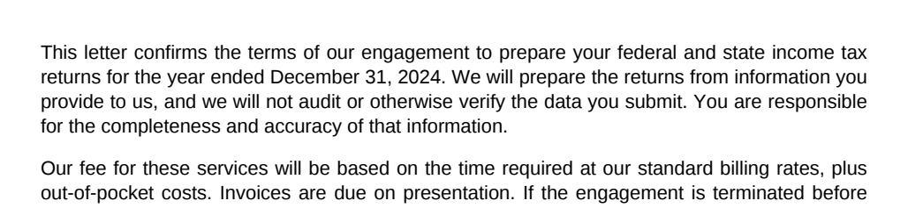 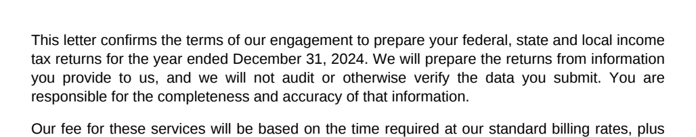
  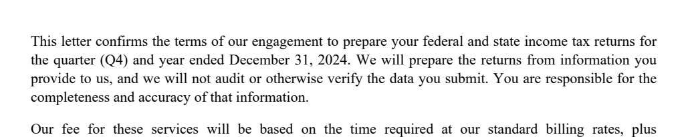
  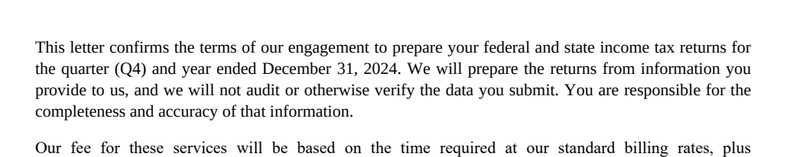
- **Memo:** before, B (Liberation from the firm folder), B-proposed (Carlito), D (Noto
  Sans, runs into the next paragraph):
  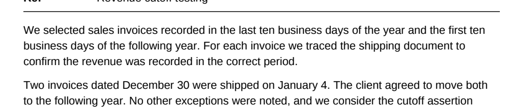 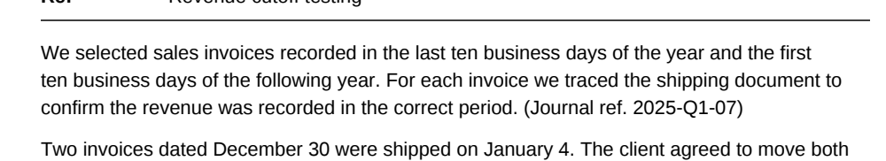
  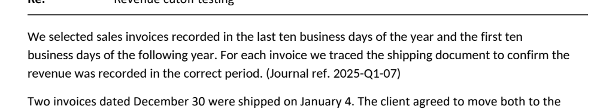 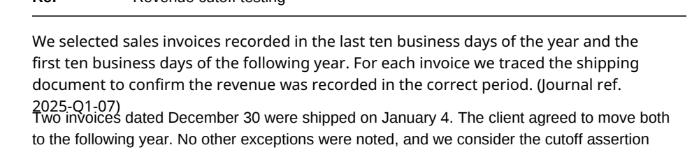
- **PBC cell:** before, C (Arial):
  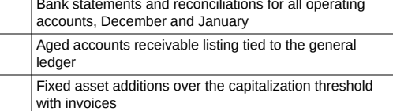 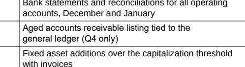
- **Form header:** before, A (wraps across the thick rule):
  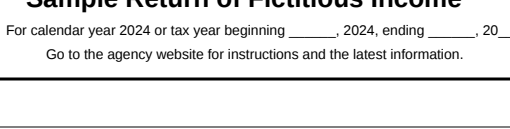 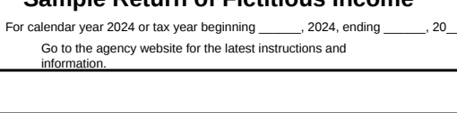
- **Two-column:** before, B (runs into the paragraph below):
  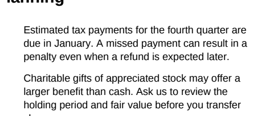 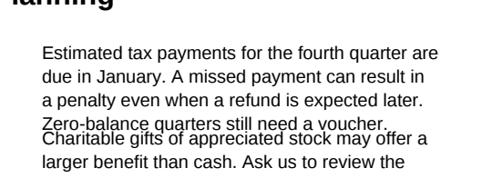
- **Images:** a bitmap added, moved, resized, rotated 15° and replaced, plus a JPEG kept
  as JPEG (bottom left): 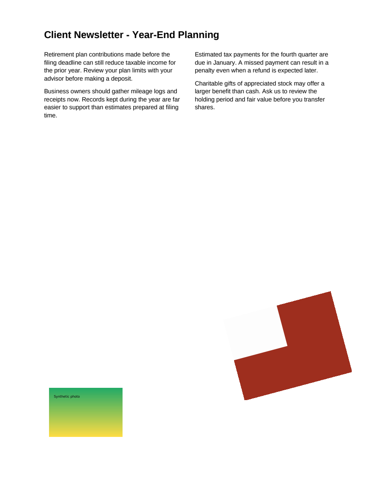

### Images (probe, `run.mjs` `imageProbe`)

- Add (bitmap), move, resize, rotate, replace and delete all work through PDFium.
- A JPEG goes in unchanged through `FPDFImageObj_LoadJpegFileInline` (FILEACCESS callback
  via `addFunction`).
- After saving and reopening, the image count went 2 → 1 after the delete.

### What Acrobat must confirm (not done)

Looks right, text selectable, Ctrl+F finds the new words, Document Properties > Fonts
lists the new fonts as "Embedded Subset", and Acrobat's own Edit PDF can edit the new
paragraph. Guide: `docs/testing/b3-spike-acrobat-check.md`. Every Acrobat result is
**pending owner**.

## Step 3: libraries (all verified 2026-10-23 on npm and crates.io)

| Library                                 | Version            | License           | Last release | Role                                       | Verdict                                                                                                                   |
| --------------------------------------- | ------------------ | ----------------- | ------------ | ------------------------------------------ | ------------------------------------------------------------------------------------------------------------------------- |
| **harfbuzzjs**                          | 1.6.4              | MIT               | 2026-10-22   | shaping, coverage, metrics, **subsetting** | **Use.** Official HarfBuzz WASM, very active. Subset WASM 684 KB, shaper 444 KB.                                          |
| opentype.js                             | 2.0.0              | MIT               | 2026-05-06   | parsing                                    | Not needed. Our own ~100-line table reader covers name/OS/2/head/post/TTC.                                                |
| fontkit                                 | 2.0.4              | MIT               | 2024-08-09   | parsing, subsetting                        | No. Quiet for 2 years; HarfBuzz subsets better.                                                                           |
| subset-font                             | 2.9.0              | BSD-3-Clause      | 2026-09-20   | wrapper over harfbuzzjs                    | Not needed; we call the subsetter directly.                                                                               |
| hb-subset-wasm                          | 0.4.0              | MIT               | 2026-04-07   | 3rd-party HarfBuzz build                   | No; use the official build.                                                                                               |
| @pdf-lib/fontkit                        | 1.1.1              | MIT               | 2022-04-06   | spike only: makes the samples              | Dev-only, test fixtures only.                                                                                             |
| Rust: ttf-parser                        | 0.25.1             | MIT OR Apache-2.0 | 2024-11-29   | parsing                                    | Fine, but the engine must run in Node.                                                                                    |
| Rust: rustybuzz                         | 0.20.1             | MIT               | 2024-11-12   | shaping                                    | Same.                                                                                                                     |
| Rust: allsorts                          | 0.17.0             | Apache-2.0        | 2026-05-13   | parse, shape, subset                       | Same.                                                                                                                     |
| Rust: skrifa / read-fonts / write-fonts | 0.49 / 0.46 / 0.55 | MIT OR Apache-2.0 | 2026-10-21   | Google fontations                          | Same. Its subsetter (klippa) isn't on crates.io under that name; the crate called `klippa` there is an unrelated project. |
| Rust: subsetter (typst)                 | 0.2.6              | MIT OR Apache-2.0 | 2026-06-04   | subsetting                                 | Same.                                                                                                                     |

- **Recommendation:** harfbuzzjs in `src/engine` (runs in the WebView, the worker and
  Node/MCP). Rust only lists font folders (Windows, user, firm UNC share) and reads the
  files.
- **License flag:** harfbuzzjs is MIT. HarfBuzz itself (inside the WASM) uses the
  permissive "Old MIT" text, which isn't word-for-word MIT. `npm run license-check`
  passes because it reads the package's `MIT`. **Owner to confirm** that's acceptable
  before it becomes a runtime dependency.
- **Spike dev dependencies added:** harfbuzzjs 1.6.4 (MIT) and @pdf-lib/fontkit 1.1.1
  (MIT; pulls pako, MIT, already in the tree). Noto Sans comes from
  `@embedpdf/fonts-latin` (OFL-1.1, already installed with EmbedPDF).

## Step 4: what needs custom code beyond PDFium, with effort

"PDFium does it" means one call works. The days are rough focused-work estimates for
production quality with tests.

| #   | Piece                                                                                                                                            | PDFium?                                           | Custom code                                                                        | Effort     |
| --- | ------------------------------------------------------------------------------------------------------------------------------------------------ | ------------------------------------------------- | ---------------------------------------------------------------------------------- | ---------- |
| 1   | Remove a paragraph's text, write new real text                                                                                                   | yes                                               | wrapper                                                                            | 1 d        |
| 2   | Paragraph grouping (lines, boxes, paragraphs, columns, cells, lists)                                                                             | chars only                                        | all of it; keep tuning on real PDFs                                                | 6-8 d      |
| 3   | Text objects shared between two boxes (one run across two cells): today we'd delete both                                                         | no split API                                      | rewrite the leftover part as a new object                                          | 2-3 d      |
| 4   | Line wrap, alignment (left/centre/right/justify), line spacing                                                                                   | no                                                | all                                                                                | 3-4 d      |
| 5   | Character spacing, word spacing (Tc/Tw), kerning                                                                                                 | **no setter**; SetText writes no kerning          | per-glyph positioning or our own content-stream writer                             | 3-5 d      |
| 6   | Mixed styles inside a paragraph (bold word, coloured word), underline (drawn as a line)                                                          | per object only                                   | run model, one object per style run, underline paths                               | 5-7 d      |
| 7   | Box grows into text or rules below (22 of 50 written cases)                                                                                      | no                                                | detect (done in spike); push following boxes in the same column, or warn           | 3-5 d      |
| 8   | Missing-letter check: **`FPDFText_SetText` silently writes .notdef (blank box) and returns success**                                             | no                                                | read each letter back (done in spike)                                              | 1 d        |
| 9   | Widths of a PDF's own subset fonts (no cmap/OS/2/name in the embedded program)                                                                   | bounds only                                       | measure through PDFium (done in spike, exact)                                      | 0.5 d      |
| 10  | Font index: Windows, user, firm share (UNC, offline), TTC, cache                                                                                 | no                                                | Rust lists folders, TS reads tables                                                | 3 d        |
| 11  | fsType embedding permission + warnings                                                                                                           | no                                                | done in spike                                                                      | 1 d        |
| 12  | Subset to the needed letters                                                                                                                     | **no**: `FPDFText_LoadFont` embeds the whole file | HarfBuzz subset first (done in spike)                                              | 2 d        |
| 13  | Subset font names: PDFium writes `/Calibri`, but the PDF spec wants `/ABCDEF+Calibri`                                                            | no                                                | post-save fix. The spike used pdf-lib; production would use qpdf JSON like Phase 2 | 1-2 d      |
| 14  | Font matching + "closest font" proposals                                                                                                         | no                                                | done in spike (name, weight, italic, serif, mono, width)                           | 2-3 d      |
| 15  | Bold/italic toggles: switch to the family's bold face; fake bold when there isn't one                                                            | render mode only                                  | face lookup, fallback                                                              | 1-2 d      |
| 16  | Images: add/move/resize/rotate/replace/delete, JPEG kept                                                                                         | yes                                               | PNG via our decoder (Phase 2), handles in UI                                       | 2 d engine |
| 17  | Undo/redo                                                                                                                                        | n/a                                               | whole-file snapshots exist; commit an edit when the box is left                    | 1-2 d      |
| 18  | In-place editor UI: overlay box, caret, selection, toolbar (font, size, colour, B/I/U, align, spacing), font picker with warnings, image handles | no                                                | all                                                                                | 12-15 d    |
| 19  | Tests: engine units, e2e, Acrobat round trip                                                                                                     | n/a                                               | all                                                                                | 3-4 d      |

**Total: about 52-70 working days.** The biggest pieces are the editor UI (18),
grouping (2) and mixed styles (6). Not covered:

- rotated or skewed text
- vertical/CJK/RTL scripts
- Type 3 and Type 1 fonts (Type 1 can't be subset by HarfBuzz; we'd need to switch fonts)
- text inside form XObjects
- tagged-PDF structure updates

## Findings a later step must know

- **PDF subset fonts have no cmap, OS/2 or name table** (pdf-lib and Word both strip
  them). Letter coverage and widths must come from PDFium, not from the font program.
  Proposals can't use the subset's metrics, so they use the width of the original line.
- `FPDFText_SetText` reports success for letters the font lacks. Always read back.
- `FPDFPage_GenerateContent` rewrote the page with no visible change outside the edited
  box (0 pixels differed in all 50 written cases).
- Grouping is the risky part. Plan time to collect real staff PDFs (tested locally, not
  committed) before building UI on it.

## Stage 1, step 0: real-format samples (2026-10-26)

There are no real staff PDFs yet, so `tests/corpus/edit/real-format/generate.mjs` writes
6 synthetic pages the way tax software writes them. Fonts are the standard 14
(Helvetica, Times, Courier), **not embedded**. Content streams are written by hand:
`Tf 1` plus a scaling `Tm`, TL/T\* blocks, Tw justification, TJ kerning, Tc/Tz, one Tj
per glyph with no spaces, space-padded Courier columns, and form data overlaid after
the form. Expectations can now say "one box with these lines" (`box: true`) for address
blocks.

| File                    | What it tests                                                | Grouping | Re-typeset                       |
| ----------------------- | ------------------------------------------------------------ | -------- | -------------------------------- |
| `form-9999`             | form page, `Tf 1` + Tm, dot leaders, Courier overlay         | 35/35    | label: clash (leaders), data: ok |
| `statement-courier`     | Courier statement, one Tj holds description + amount         | 16/16    | **fail: shared objects**         |
| `transmittal-letter`    | Times, TL/T\* blocks, Tw justify, TJ kerning, address blocks | 12/12    | ok (clash for wider fonts)       |
| `filing-instructions`   | Tm everywhere, ruled 2-column table, bullets with Tz 95      | 18/18    | ok                               |
| `k1-supplemental`       | 7 pt, bold run-in heads, Tc 0.15, Tz 92                      | 12/12    | ok (whole note turns bold)       |
| `print-driver-per-char` | one Tj per glyph, no space characters                        | 7/7      | ok                               |

Spike samples (committed + local Windows fonts) still pass 10/10 for grouping and 50/50 for edits.
Re-typeset on real-format: 56 cases, 19 ok, 11 clash, 21 correct refusals, **5 fail** (all
the statement row, see below).

**Grouping changes (in `group.mjs`/`pdfium.mjs`):**

1. **Font size from the matrix.** `FPDFText_GetFontSize` returns the `Tf` size only, so
   `Tf 1` + Tm text came out as 1 pt and every threshold broke. The size is now scaled by
   the char matrix (`FPDFText_GetMatrix`). This alone was most of the misses: before it,
   form 12/35 and filing instructions 2/18.
2. **Dot leaders** (4+ periods) start their own segment, so labels stay editable alone.
3. **Typed rules** (`-----`, `=====`, 5+ chars) never join a box and separate the boxes
   above and below them, like a drawn rule.
4. **Amount lines** (`1,234.`, `$ 812`, `(45)`) are always their own paragraph, so a
   column of numbers never reflows into one paragraph.

**Re-typeset changes (in `retypeset.mjs`):**

5. **Read back every letter for every font**, not only the PDF's own. The spike never
   checked firm/Windows fonts. Noto Sans has no `≥ → ≠ ≤`, and those edits were written
   as blank boxes. Now nothing is removed until the new text reads back, otherwise it
   refuses (6 cases, each confirmed against HarfBuzz coverage).
6. **One-line paragraphs grow to the right instead of wrapping** at their own width. A
   form label wrapped one word per line before. This also fixed the spike's `irs-header`
   clash. _I think Acrobat does the same; needs your Acrobat check._
7. **Metric twins for the standard 14**: Helvetica → Arial / Liberation Sans, Times →
   Times New Roman / Liberation Serif, Courier → Courier New / Liberation Mono, ahead of
   proposals (`fonts.mjs`).
8. The check now uses the bounds of what was written when the text no longer groups on
   its own (it ran into leaders), so that counts as a clash, not a failed edit.

**Findings:**

- **Shared text objects are real in tax output.** In Courier statements one Tj holds the
  description _and_ the amount. Editing "SECOND SAMPLE CREDIT UNION" deletes `812.` and
  `422.` (410 px outside the box, all 5 font cases). This is the stage 1 "split shared
  objects" item; the statement stays a failing check until the engine does it.
- **Standard 14 fonts, keep the original font:** works for any WinAnsi letter, and the
  font stays not embedded (as in the original). Letters outside WinAnsi (`Ł`, `≥`, `→`)
  are refused, and B/C switch to the metric twin, embedded as a subset.
- **Proposals without the twin:** Helvetica → Tahoma / Segoe UI (x0.97-0.99), Courier →
  DejaVu Sans Mono / Lucida Console (x1.00), Times → Cambria / Georgia (x1.06-1.09: no
  close serif on Windows without Liberation Serif). Worth putting Liberation Serif/Mono
  (OFL) in the firm font folder.
- **One style per paragraph** takes the first letter's style, so a K-1 note with a bold
  run-in head becomes all bold. For stage 1 I'd use the most common style instead; the
  head itself needs mixed styles (stage 2).
- **Bullets and Tz:** a re-typeset bullet item loses its hanging indent, and Tz 95/92 text
  is rewritten at 100% (wider). Both are engine work (keep the indent; PDFium has no Tz
  setter, so scale the object's matrix).
- **Overlap false positive:** the statement's B cases flag the dash line above because
  Courier New's loose box is taller. The engine should test overlap with tight bounds.
- **Generator note:** pdf-lib's `widthOfTextAtSize` adds AFM kerning, which `Tj` never
  applies. The real-format generator sums per-letter widths instead.

Run: `npm run corpus:edit`, then `npm run spike:edit` (now includes real-format and the
grouping report). Grouping alone:
`node scripts/spikes/b3-edit/group-report.mjs tests/corpus/edit/real-format`.

## Files

- `scripts/spikes/b3-edit/`: `pdfium.mjs` (raw PDFium helpers), `group.mjs`,
  `fonts.mjs` (tables, index, fsType, matching, HarfBuzz subset), `retypeset.mjs`, `run.mjs`.
  All throwaway, dev-only.
- `tests/corpus/edit/`: `generate.mjs`, 5 PDFs and their expected JSON.
- `docs/edit-spike/`: screenshots. `docs/testing/b3-spike-acrobat-check.md`.
